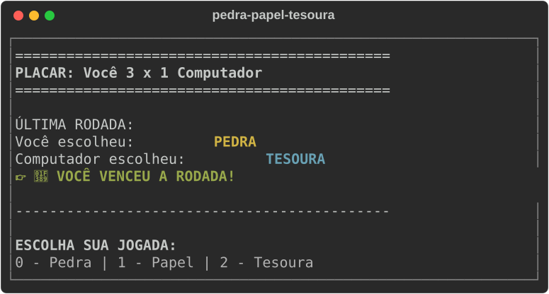

# ✂️ Pedra, Papel e Tesoura em Python | Exercício de Lógica de Programação


[](https://github.com/ryanvmorais/python-pedra-papel-tesoura/actions/workflows/ci.yml)


Este repositório contém o clássico jogo **Pedra, Papel e Tesoura (Jokenpô) em Python**, projetado como material de estudo para desenvolvedores iniciantes. O foco principal é a aplicação prática de **fundamentos da programação** e o uso de dicionários para mapear regras de negócio no terminal.

### 🎯 Objetivo do Projeto:

Demonstrar a aplicação de **estruturas de repetição**, **manipulação de coleções (listas e dicionários)** e **Programação Orientada a Objetos (POO)** em Python. É um projeto prático ideal para estudantes que desejam entender como transformar regras do mundo real em algoritmos eficientes.

---

### 📚 O que você vai aprender com este projeto?

Este exercício foi estruturado para consolidar conceitos essenciais de algoritmos:

- **Estruturas de Repetição:** controle do fluxo contínuo de rodadas (loop `while`).
- **Dicionários (Mapping):** como substituir múltiplos `if/else` por um mapeamento lógico de vitória (`chave` vence `valor`).
- **Tratamento de Erros:** uso de blocos `try/except` para validar entradas numéricas do usuário.
- **POO (Orientada a Objetos):** organização de código modular através da classe `PedraPapelTesoura` e uso do `self`.
- **Interação Multiplataforma com o SO:** uso de `os.system` para detectar o sistema operacional (`cls` no Windows ou `clear` em Unix/Mac) e manter a interface do terminal limpa e profissional.

---

### 🧠 Guia de Implementação (A Lógica por trás do Código):

Para quem está começando, o maior desafio não é a sintaxe, mas a **montagem do raciocínio**. Confira o passo a passo da construção deste jogo:

1. **Facilitando a Escolha (Listas e Índices):** em vez de pedir para o usuário digitar "pedra" (e correr o risco de ele errar uma letra e o código travar), usamos uma lista: `['pedra', 'papel', 'tesoura']`. O usuário só digita o número (0, 1 ou 2). O Python entende que o número 0 é a Pedra, o 1 é o Papel e o 2 é a Tesoura. Isso evita erros e deixa o jogo mais rápido.
2. **O "Truque" do Dicionário (Regras de Vitória):** sabe aquele monte de `if` e `else` que a gente costuma fazer? Aqui usamos um **Dicionário**. É como uma tabela: dizemos que a Pedra vence a Tesoura, o Papel vence a Pedra, e assim por diante. O código só precisa olhar essa "tabela" para saber quem ganhou. É muito mais limpo e fácil de ler!
3. **Organizando a Casa (Classes e o tal do `self`):** usamos uma **Classe** chamada `PedraPapelTesoura`. Pense nela como uma caixa que guarda tudo o que o jogo precisa: o placar, as regras e as jogadas. O `self` serve para o jogo saber que ele está mexendo no seu *próprio* placar e não em algo de fora. Isso evita aquela bagunça de variáveis espalhadas pelo código.
4. **O Coração do Jogo (Game Loop):** o jogo roda dentro de um "laço" (*loop*) que não para até você pedir. Ele segue sempre esta ordem: `limpa a tela` -> `pede sua jogada` -> `sorteia a jogada do computador` -> `mostra quem venceu` -> `pergunta se quer jogar de novo`. É assim que quase todo jogo funciona!
5. **Conversando com o seu Computador:** usamos um comando especial (`os.system`) para falar com o sistema operacional (`Windows`, `Mac` ou `Linux`). Ele descobre qual sistema você usa e limpa a tela do terminal automaticamente, deixando o jogo com uma aparência muito mais bonita e organizada.
6. **Proteção contra Erros (Try/Except):** e se o jogo pedir um número e o usuário digitar uma letra? Normalmente o programa fecharia com um erro feio. Aqui usamos o `try/except`, que "tenta" fazer algo e, se der erro, avisa o usuário educadamente em vez de travar tudo.

---

### 🛠️ Tecnologias e Ferramentas:

Para garantir a melhor experiência de aprendizado, o projeto utiliza as seguintes tecnologias:

| Ferramenta | Descrição |
| :--- | :--- |
| **Python 3.12+** | Linguagem principal do projeto. O jogo usa só a biblioteca padrão, sem dependências externas. |
| **uv** | Gerenciador de dependências e ambientes virtuais: cria o ambiente e roda o jogo com um único comando. |
| **Terminal** | Interface onde o jogo roda e recebe as jogadas do usuário (CMD, PowerShell ou o terminal do VS Code/PyCharm). |

As ferramentas de qualidade (Ruff, Black, Mypy e Pytest) estão em [Qualidade e testes](#qualidade-e-testes). Para o porquê de cada escolha, veja [docs/stack.md](docs/stack.md).

---

### ⚙️ Como rodar o projeto localmente:

**Pré-requisitos:** [Python 3.12+](https://www.python.org/downloads/) e [uv](https://docs.astral.sh/uv/getting-started/installation/). Para conferir, rode `python --version` e `uv --version`.

1.  **Clone o repositório:**
    ```bash
    git clone https://github.com/ryanvmorais/python-pedra-papel-tesoura.git
    cd python-pedra-papel-tesoura
    ```
2.  **Execute o jogo:** no terminal (CMD, PowerShell ou o do VS Code/PyCharm), dentro da pasta do projeto. O `uv` cria o ambiente virtual sozinho na primeira execução.
    ```bash
    uv run main.py
    ```
3.  **Prefere dois cliques? Use o atalho:** no Windows, abra o `iniciar_jogo.bat`; no Linux/macOS, execute o `iniciar_jogo.sh` no terminal. Os scripts detectam se você tem `uv` (preferido) ou `python`/`python3` instalado antes de iniciar a partida.

> ⚠️ **Nota:** sem o `uv`, `python main.py` funciona igual, porque o jogo não tem nenhuma dependência externa. O jogo também detecta se você está no Windows, Linux ou macOS para limpar a tela do jeito certo.

---

### Qualidade e testes

O projeto tem uma suíte de testes automatizados (`pytest`) e um portão de qualidade que roda no CI a cada push e a cada PR:

```bash
uv sync                 # instala as dependências de desenvolvimento
uv run ruff check .     # lint + ordem de imports
uv run black --check .  # formatação
uv run mypy             # checagem de tipos
uv run pytest           # testes
```

Para o mapa de cada tecnologia da stack (o que é, por que foi escolhida, o que estudar), veja [docs/stack.md](docs/stack.md). Para o comportamento esperado do jogo e o histórico de decisões, veja [specs/](specs/). Para o detalhamento de arquitetura e convenções, veja [CLAUDE.md](CLAUDE.md).

---

### 📋 Atividades para praticar (Desafios de Evolução):

Para exercitar o que aprendeu, tente modificar o código e implementar estas novas funcionalidades:

1. **🏆 Placar Acumulado:** crie um contador que não zere ao reiniciar uma partida. Implemente variáveis de controle (ex.: `pontos_usuario` e `pontos_computador`) dentro do método `__init__` da classe e garanta que, ao reiniciar o loop de jogadas, elas persistam e sejam exibidas no placar a cada novo turno.
   - **O Aprendizado:** diferenciar variáveis que controlam a **rodada atual** das que controlam o **histórico global do usuário**, mantendo dados consistentes em aplicações com vários ciclos de execução (Game Loops).
2. **🤖 Modo "Melhor de 3":** faça o jogo encerrar e declarar um Grande Campeão assim que o usuário ou o computador atingir 2 vitórias.
   - **O Aprendizado:** usar o estado guardado no objeto (`self`) para decidir quando o loop termina, em vez de depender só da resposta "jogar de novo?".
3. **⏲️ Efeito de Suspense:** use o módulo `time` e a função `time.sleep(1)` para exibir "Pedra...", "Papel..." e "Tesoura!" com pausas antes de revelar a jogada da máquina.
   - **O Aprendizado:** importar um módulo da biblioteca padrão e controlar o ritmo da interação no terminal.

---

### 🧭 Continue praticando:

Este projeto faz parte de uma trilha de exercícios de lógica de programação em Python. Depois deste, experimente:

- **[Jogo da Velha em Python](https://github.com/ryanvmorais/python-jogo-da-velha):** matrizes e Programação Orientada a Objetos.
- **[Jogo da Cobrinha em Python](https://github.com/ryanvmorais/python-jogo-da-cobrinha):** listas dinâmicas e game loop com `curses`.

Veja todos os projetos e vídeos do canal em [aprenda-com-ryan-morais](https://github.com/ryanvmorais/aprenda-com-ryan-morais).

---

### 💡 Ficou com alguma dúvida ou tem sugestões?

Aprender algo novo tem seus desafios, mas estou aqui para caminharmos juntos! Se você encontrou algum erro, teve dificuldade em rodar o jogo ou pensou numa melhoria que tornaria este material ainda mais didático:

- **Abra uma [Issue](https://github.com/ryanvmorais/python-pedra-papel-tesoura/issues):** descreva sua dúvida ou sugestão. É a melhor forma de trocarmos conhecimento e ajudarmos outras pessoas que tenham a mesma dúvida.
- **Contribua com código:** quer propor uma melhoria? Veja o passo a passo no [CONTRIBUTING.md](CONTRIBUTING.md).
- **Me mande um e-mail:** se preferir algo mais privado, escreva para [**contato@ryanmorais.com.br**](mailto:contato@ryanmorais.com.br).

Ficarei muito feliz em ver seu progresso e receber seu feedback para melhorar cada vez mais nossos materiais de estudo! 🤝

---

### ⚖️ Licença

Este projeto está sob a **Licença MIT**. Isso significa que você pode usar, copiar e modificar o código à vontade, inclusive nos seus projetos. Para mais detalhes, consulte o arquivo [LICENSE](LICENSE).
